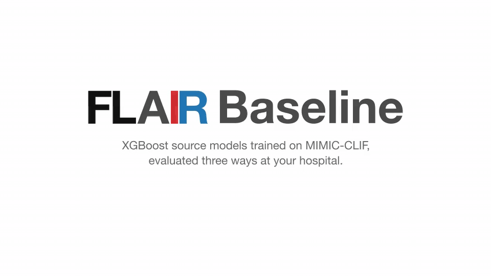

# FLAIR Baseline

Evaluate source XGBoost models at an external CLIF site, or train the source models on MIMIC. Patient-level data stays at the site.

The baseline runs on top of the [FLAIR](../FLAIR) CLI. Cohorts, Table 1, STROBE and the snapshot come from `flair load-task`, reports come from `flair build-report`, and the config comes from `flair init-config`. FLAIR also creates the output folders. The baseline adds the shared CLIF→MEDS pull, featurization, the XGBoost models and the three model kinds.



## Choose A Workflow

| Who | Goal | Data preparation | Commands after preparation |
|---|---|---|---|
| External site | Compare all three approaches | Full cohort | `external-validation`, `transfer-learning`, `local-training` |
| MIMIC model owner | Build the model bundle | Full cohort plus a new vocabulary | `local-training` via `run_mimic_train.sh` |

External sites must prepare the full cohort. Do not use `--holdout-only` because transfer learning and local training require the train split.

## One-Time Setup

Install the environment from the repository root:

```bash
uv sync
```

Create the config required by your role:

| Role | Command | Required `site` value |
|---|---|---|
| External CLIF site | `uv run flair init-config --out config` | A short local site name |
| MIMIC model owner | `uv run flair init-config --out config && mv config/clif_config.json config/clif_config_mimic.json` | `mimic` |

Edit the generated file and set `site`, `data_directory` and `timezone`. Config fields are listed in [Config Parameters](#config-parameters).

## External Sites

Copy the published `mimic_baseline_models/` folder into the repository root. Prepare the full cohort once, then run all three model commands:

```bash
uv run flair-baseline prepare \
  --clif-config config/clif_config.json \
  --out . \
  --pmc

uv run flair-baseline external-validation \
  --models-dir mimic_baseline_models \
  --clif-config config/clif_config.json \
  --out .

uv run flair-baseline transfer-learning \
  --models-dir mimic_baseline_models \
  --clif-config config/clif_config.json \
  --out . \
  --hpo-trials 10

uv run flair-baseline local-training \
  --clif-config config/clif_config.json \
  --out . \
  --hpo-trials 10
```

`prepare` runs `flair load-task` for every task and creates a new FLAIR snapshot (`<site>_flair_v<version>/`). Snapshots are optional. On later runs, pass `--snapshot <site>_flair_v<version>` to `prepare`, `build-cohorts` or `build-data` to reuse the frozen encounter IDs. Without it, FLAIR replaces the snapshot.

The model commands are independent after `prepare`. The external-site training commands above limit HPO to 10 trials. Add `--no-hpo` to `transfer-learning` and `local-training` for a faster fixed-parameter run instead.

<details>
<summary><strong>MIMIC Model Owner</strong></summary>

Build cohorts, create the shared data, generate the source vocabulary, featurize, and train all four models:

```bash
uv run flair-baseline build-cohorts \
  --clif-config config/clif_config_mimic.json \
  --out .

uv run flair-baseline build-data \
  --clif-config config/clif_config_mimic.json \
  --out .

uv run flair-baseline build-vocab \
  --clif-config config/clif_config_mimic.json \
  --out .

uv run flair-baseline featurize \
  --clif-config config/clif_config_mimic.json \
  --out .

./run_mimic_train.sh
```

The training script runs all tasks smallest-first and resumes from stamps in `.mimic_run_stamps/`. Delete that directory to retrain every task. Pass `--no-hpo` for a faster fixed-parameter run or `--hpo-trials N` to change the search budget. Do not pass `--task` to this wrapper; use `local-training --task NAME` directly for a single task.

Publish only this model bundle:

```text
mimic_baseline_models/
  <task>/local/model.json
  <task>/local/vocab.json
  <task>/local/params.json
```

`model.json` and `vocab.json` are required by external sites. `params.json` is included for auditability.

</details>

## Workflow Parameters

The recommended values for each workflow are:

| Parameter | External sites | MIMIC owner |
|---|---|---|
| `--clif-config` | `config/clif_config.json` | `config/clif_config_mimic.json` |
| `--out` | `.` | `.` |
| `--models-dir` | `mimic_baseline_models` for external validation and transfer learning | Not used |
| `--holdout-only` | No | No |
| `--pmc` | Recommended | Optional on `build-data` |
| `--task` | Omit for all tasks | Omit for all tasks |
| `--no-hpo` | Optional for transfer and local training | Optional |

### Shared CLI Parameters

| Parameter | Default | Commands | Meaning |
|---|---|---|---|
| `--clif-config PATH` | `config/clif_config.json` | All | CLIF site config file (`flair init-config`) |
| `--out PATH` | `.` | All | Root directory for site-prefixed outputs |
| `--task NAME` | All tasks | All except `build-vocab` | Run one exact task name or unique task prefix |

### Data Preparation Parameters

| Parameter | Default | Commands | Meaning |
|---|---|---|---|
| `--elf-config PATH` | `flair_elf_config.yaml` | `prepare`, `build-data` | ELF domain configuration |
| `--snapshot PATH` | Unset (new snapshot) | `prepare`, `build-cohorts`, `build-data` | Reuse an earlier FLAIR snapshot's frozen encounter IDs; passed to `flair load-task` |
| `--holdout-only` | Off | `prepare`, `build-data`, `featurize` | Process only test rows; not used by the required external-site workflow |
| `--full-cohort` | On | `prepare`, `build-data`, `featurize` | Process train and test rows |
| `--pmc` | Off | `prepare`, `build-data` | Batch ETL to reduce peak memory |
| `--no-pmc` | On | `prepare`, `build-data` | Run ETL without batching |
| `--batch-size N` | `4000` | `prepare`, `build-data` | Encounters per batch when `--pmc` is enabled |
| `--vocab-out PATH` | `vocab.json` | `build-vocab` | Destination for the generated source vocabulary |

If `build-data` fails with `InvalidInputException: Attempting to execute an unsuccessful or closed pending query result`, set FLAIR's `FLAIR_MEDS_WORKERS=1` to make the MEDS extraction run serially. For example: `FLAIR_MEDS_WORKERS=1 uv run flair-baseline prepare ...`. The error comes from clifpy, which shares one DuckDB connection across FLAIR's parallel domain workers.

FLAIR assigns the split: a deterministic 75/25 split for MIMIC, and a temporal 75/25 split (oldest/newest) by stitched encounter for every other site.

### Model Parameters

| Parameter | Default | Commands | Meaning |
|---|---|---|---|
| `--models-dir PATH` | Required | `external-validation`, `transfer-learning` | Published source model bundle |
| `--vocab PATH` | `vocab.json` | `local-training` | Fixed vocabulary used for a new local model |
| `--report` / `--no-report` | Report on | All model commands | Run `flair build-report` (JSON + `viz/` PNGs) |
| `--hpo` / `--no-hpo` | HPO on | `local-training`, `transfer-learning` | Enable Optuna search or use fixed parameters |
| `--hpo-trials N` | `30` | `local-training`, `transfer-learning` | HPO trial budget |

## Tasks

Use one of these values with `--task`. Add the same `--task` value to `prepare` and every subsequent model command in an external-site workflow.

| Task | Outcome |
|---|---|
| `icu_daily_mortality` | ICU daily in-hospital mortality |
| `icu_daily_ltach` | ICU daily LTACH discharge |
| `extubation_failure_24h` | Extubation failure within 24 hours |
| `icu_readmission` | ICU readmission |

## Config Parameters

| Field | Required | Default | Meaning |
|---|---|---|---|
| `site` | Yes | None | Site label used in output folder names; use `mimic` for the source site |
| `data_directory` | Yes | None | Directory containing local `clif_*` files |
| `filetype` | Yes | None | `parquet` or `csv` |
| `timezone` | Yes | None | Site IANA timezone, e.g. `US/Eastern` |

These are FLAIR's own config keys (see the FLAIR README). FLAIR fixes the stitching gap at 6 hours and rejects the old `stitch_time_interval_hours` and `cache_directory` keys.

The default workflow expects these CLIF tables:

| Required CLIF tables |
|---|
| `patient`, `hospitalization`, `adt` |
| `vitals`, `labs`, `respiratory_support`, `patient_assessments` |
| `medication_admin_continuous`, `medication_admin_intermittent` |

Files are normally named `clif_<table>.parquet` or `clif_<table>.csv`. `hospital_diagnosis` is optional and enriches Table 1 when available.

## External Site Sharing

Share both generated folders:

```text
<site>_flair_non_phi_for_upload/
<site>_baseline_models/
```

The non-PHI folder holds, per task, FLAIR's `table1.json` and STROBE PNGs, the baseline's `codes.parquet`, and one `report/<kind>/` directory per model command. The models folder contains the generated local and transfer-learning models.

Do not upload:

```text
<site>_flair_phi/
<site>_flair_v<version>/
mimic_baseline_models/
```

The PHI folder contains cohorts, features, MEDS events and predictions. The snapshot holds encounter IDs. Both must remain at the site.
